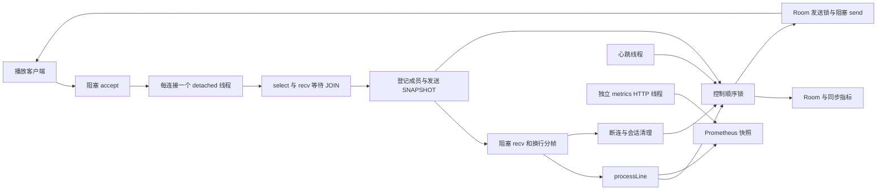
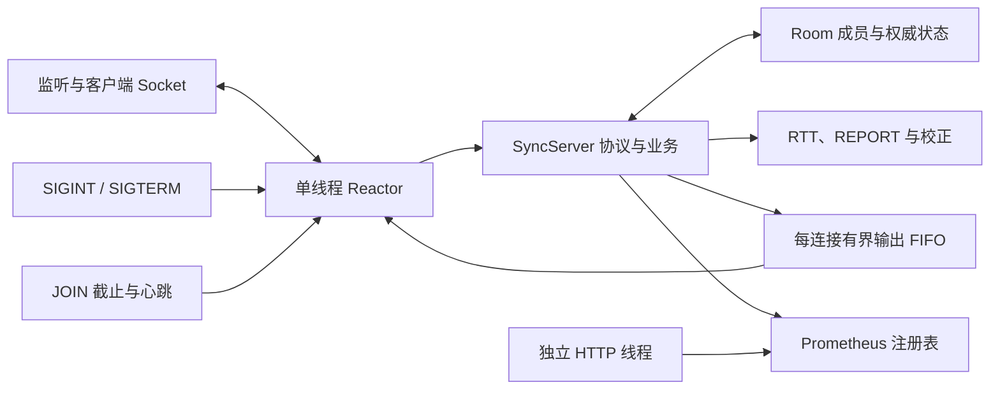
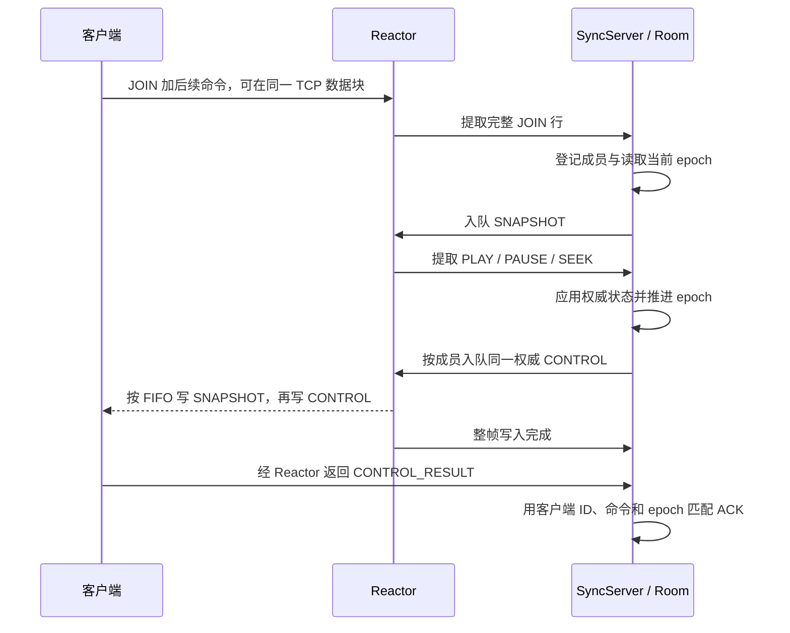

# Linux 服务端架构审查

审查基线为 `88698b1aab544595289d7a0fe1ffd5972ff811ea`。开发分支为 `codex/linux-reactor`。

## 基线调用链



以下位置均为基线提交中的行号。

| 路径 | 代码行为 |
| --- | --- |
| `SyncServer.cpp:1045–1184` | 创建监听 fd、Room、采集器及 HTTP 端点，启动心跳后阻塞 `accept`。每个连接的线程以引用捕获共享对象并 detach。退出路径只 join 心跳和 metrics 线程。 |
| `SyncServer.cpp:181–271, 781–996` | 5 秒 JOIN 截止时间、4 KiB 握手缓冲，空行跳过。有效 JOIN 登记成员并在控制锁内先写 SNAPSHOT，已缓冲的后续消息进入 `handleClient`。媒体不匹配时返回 `REJECT MEDIA_MISMATCH`。 |
| `SyncServer.cpp:273–666` | `processLine` 处理 PONG、首帧、控制 ACK、REPORT、校正 ACK 和控制命令。控制锁覆盖 Room 版本更新、广播、指标 epoch，以及 REPORT 生成和发送校正。 |
| `Room.cpp:44–127, 129–202, 235–242` | Room 按 Socket 记录成员。控制操作推进播放状态和 epoch，复制接收列表后释放状态锁，通过全局发送锁逐目标阻塞写。最后一位成员离开会清空媒体与播放状态。 |
| `SyncServer.cpp:668–779, 999–1042` | 已加入连接持续收行。断连在控制锁下清理成员和指标，再关闭 fd。心跳在同一控制锁下登记待配对 PING 并发送。 |
| `MetricsHttpServer.cpp:176–296` | 本地 HTTP 线程串行处理 scrape。停止线程时关闭监听 fd 后 join。客户端接收设定了单次读超时，发送无超时。 |
| `SyncMetrics.cpp:318–807`、`Telemetry.cpp:278–296` | 每次 REPORT 遍历有进度数据的其他成员并计算成对统计，输出逐对文本日志。启用 JSONL 时每条事件同步 flush。 |

## 风险与验证假设

- 源码确认服务器退出时未等待连接线程，栈对象析构与后台访问可能重叠。Linux `FD_SET` 对超出 `FD_SETSIZE` 的 fd 没有边界保护。已入房的输入半帧可以一直积累。
- 源码确认 `send` 处于全局发送锁内，多条发送路径还持有控制锁。慢端何时填满内核发送缓冲、对其他端的尾延迟影响，需要压测。原有控制锁覆盖房间成员的正常发送和移除，旧版存在资源退出风险，正常路径上未确认已出现 fd 错投。
- 每连接一个线程会增加线程数、栈映射与调度开销。RSS 和 CPU 的实际斜率需要测量。单房间广播仍为 O(N)，按客户端周期上报的成对统计最坏可达到 O(N²) 工作量和状态规模。
- 同步日志、指标格式化以及业务计算可能影响事件循环时延。连接容量实验和带 REPORT 的同步实验必须分别解释。

## 方案与实施顺序

| 方案 | 正确性与维护成本 | 可预期收益与约束 |
| --- | --- | --- |
| 保留每连接线程并修补退出、发送超时 | 保留跨线程锁和线程回收，协议迁移成本低 | 可限制卡顿时长，线程成本与连接数直接相关 |
| Linux 单 epoll LT 循环，串行业务 | 一处拥有连接、Room 变更和计时器，版本和快照顺序可直接推导 | 网络写入不会等待可写，单核的 REPORT 与日志工作量仍须评估 |
| epoll 加有界业务线程池 | 需要定义队列背压、按房间排序以及写入完成的跨线程交接 | 适用于可分离且经测量足够重的任务，单 Room 的权威状态仍只能按序提交 |
| 独立网络线程与单业务线程 | 可以分别限制两条流水线，需增加双向队列和连接关闭协议 | 可隔离短时业务抖动，仍需为慢消费者和已入队的业务项设定处理规则 |

采用单 epoll LT 循环，独立保留现有 HTTP 线程。先拆分 Room 的状态变更和传输，再迁移握手、发送、心跳和退出，最后用真实 Socket 回归并对照同配置的 Release 基线。是否引入业务线程池取决于 REPORT 和日志的剖析结果。协议和校正算法沿用现有实现，播放器和 Qt 目标不依赖服务端传输实现。


## 实现与消息顺序





| 文件 | 职责 |
| --- | --- |
| [ServerReactor.cpp](../ServerReactor.cpp)、[ServerTransport.h](../ServerTransport.h) | 连接与 fd 所有权、事件等待、行分帧、发送 FIFO、写入完成回调和连接计时器。Linux 使用 epoll，Windows 服务端使用 WSAPoll，其他 POSIX 使用 poll。 |
| [SyncServer.cpp](../SyncServer.cpp)、[Room.cpp](../Room.cpp) | 单线程事件处理和权威状态。Room 用逻辑连接 ID 记录成员、生成带 epoch 的控制消息，传输层编码队列与写入完成结果由 SyncServer 管理。 |
| [SyncCorrectionCoordinator.cpp](../SyncCorrectionCoordinator.cpp) | 校正先保留命令 ID，整帧写完后启动 ACK 超时。校正所属 epoch 失效且首字节尚未写出时，丢弃该帧。若已经发出部分字节则完成帧，避免破坏后续协议。 |
| [MetricsHttpServer.cpp](../MetricsHttpServer.cpp)、[PrometheusMetrics.cpp](../PrometheusMetrics.cpp) | 监控端点用独立线程，限制请求字节、读写等待及请求耗时。线程停止后再关闭监听 fd。传输指标记录全进程发送队列当前与峰值字节、背压断开和短写。 |
| [server_reactor_test.py](../tests/server_reactor_test.py)、[benchmark_server.py](../tools/benchmark_server.py) | 实际 TCP 集成回归和两个二进制的对照压测。 |

- Reactor 用从 2 起递增的连接 ID 投递 epoll 事件。关闭时撤销兴趣、关闭 fd、结算写入回调、清理成员和关联指标，再回收连接对象。旧事件即使与新 fd 同批出现，也只能查到旧 ID。Linux 用 signalfd 把 SIGINT/SIGTERM 接入事件循环，信号 mask 在启动 HTTP 线程之前建立。[epoll(7)](https://man7.org/linux/man-pages/man7/epoll.7.html) · [signalfd(2)](https://man7.org/linux/man-pages/man2/signalfd.2.html)
- 每轮最多接受 64 个连接，每连接就绪时读 512 字节、最多写 32 KiB。LT 继续报告剩余就绪数据。EINTR 重试，EAGAIN 交回事件循环，短写保存帧内偏移。收到读取半关闭后可限时排空已有响应。监听资源暂时耗尽时暂停接受 250 ms，既有连接可继续处理。[epoll(7)](https://man7.org/linux/man-pages/man7/epoll.7.html) · [accept(2)](https://man7.org/linux/man-pages/man2/accept.2.html)
- 当前连接数上限 4,096，协议单行上限 4 KiB，JOIN 截止 5 秒。每连接输出上限 64 KiB 或 2,048 帧，达到限制就关闭该连接。连续 5 秒没有写入进展会关闭仍有积压的连接。已经收到 EOF 或被拒绝的连接最多排空 1 秒。广播帧的字节存储由多个连接共享，每个连接独立保存消费位置。
- JOIN 成功和 RTT 登记以整帧写入内核为界。控制分发与期望 ACK 在权威提交时登记，广播失败在所有目标写入成功或失败后结算。客户端执行结果由 CONTROL_RESULT、CORRECT_RESULT 和后续 REPORT 区分。Prometheus 的传输队列字节按心跳采样，峰值为进程运行以来的高水位。
- 播放 Socket 收发、Room 变更与同步校正都在 Reactor 线程。CPU 密集的成对 REPORT 与同步日志写入仍会占用该线程。当前业务池没有可直接迁移且保持现有顺序的充分依据，在实际 REPORT 负载获得画像前保留串行执行。

## 构建与复现

以下命令在仓库根目录执行。Linux 集成测试需要 Python 3.8+，在本机启动服务并占用播放端口 9000。

```bash
mkdir -p out/build/reactor-baseline-source
git archive 88698b1 | tar -x -C out/build/reactor-baseline-source
cmake -S out/build/reactor-baseline-source -B out/build/reactor-baseline -DCMAKE_BUILD_TYPE=Release
cmake --build out/build/reactor-baseline --parallel
ctest --test-dir out/build/reactor-baseline --output-on-failure

cmake -S . -B out/build/reactor-release -DCMAKE_BUILD_TYPE=Release
cmake --build out/build/reactor-release --parallel
ctest --test-dir out/build/reactor-release --output-on-failure
python3 -m unittest discover -s tools/observability/tests -v
SYNCCINEMA_METRICS_PORT=9100 ./out/build/reactor-release/SyncCinemaServer
```

停止上面的手动服务后运行对照。旧版固定使用端口 9000 且没有 SO_REUSEADDR。可用临时网络命名空间隔离已有连接及 TIME_WAIT；需系统启用用户命名空间。也可等当前命名空间的 9000 端口清闲后直接运行同一个 Python 命令。

```bash
unshare -Urn bash -c '
  ip link set lo up
  python3 tools/benchmark_server.py \
    --baseline out/build/reactor-baseline/SyncCinemaServer \
    --reactor out/build/reactor-release/SyncCinemaServer \
    --connections 10 100 500 1000 --idle-seconds 2 --slow-commands 96000 \
    --output out/build/reactor-benchmark.json
'
```

```bash
cmake -S . -B out/build/reactor-asan -DCMAKE_BUILD_TYPE=Debug \
  -DCMAKE_CXX_FLAGS="-fsanitize=address,undefined -fno-omit-frame-pointer -fno-pie" \
  -DCMAKE_EXE_LINKER_FLAGS="-no-pie"
cmake --build out/build/reactor-asan --parallel
ASAN_OPTIONS=detect_leaks=1:halt_on_error=1 UBSAN_OPTIONS=halt_on_error=1 \
  ctest --test-dir out/build/reactor-asan --output-on-failure
```

在 Windows x64 Visual Studio 开发者终端执行。Qt 和 libVLC 路径由仓库的 preset 或本机覆盖项提供。

```powershell
cmake --preset x64-qt-vlc-release -B out/build/reactor-windows-qt
cmake --build out/build/reactor-windows-qt --parallel
ctest --test-dir out/build/reactor-windows-qt --output-on-failure
```

## 正确性验证

| 验证项 | 结果 |
| --- | --- |
| 基线 Linux Release | C++ 核心回归通过，原有 8 项 Python 可观测性回归通过。 |
| 新版 Linux Release | C++ 核心和 TCP 集成目标均通过。6 个 TCP 用例覆盖 JOIN、拒绝、半包和粘包、并发 epoch、144 条 ACK、RST 重连、半关闭、背压、持续 REPORT 校正及 SIGTERM 清理。 |
| 故障注入和同步 | 两个协议模拟客户端，其中一个通过原有故障代理引入 25 ms 单向延迟。1,000 ms 稳定偏差触发校正，目标回传 APPLIED 后，模拟 REPORT 对齐并记录一次收敛。原有 8 项可观测性测试通过。 |
| Windows | MSVC x64 构建 Qt/libVLC 客户端、CLI 与 WSAPoll 服务端。C++ 核心和 libVLC 播放器事件测试通过。真实 Qt 用本地 WAV 连接 Linux，日志记录 epoch 1 的 PLAY、2 的 PAUSE、3 的 SEEK 分别匹配 APPLIED，SEEK 到 36 秒。 |
| ASan / UBSan / LSan | 独立 Debug 构建的 C++ 核心和 TCP 集成回归均通过。 |
| TSan | 编译完成，WSL 上运行时在进入核心测试前报 `FATAL: ThreadSanitizer: unexpected memory mapping`，因此没有竞争检测结论。 |


## 同机 Release 性能对照

2026-11-14，WSL2 Ubuntu 22.04，Linux `6.6.87.2-microsoft-standard-WSL2`、GCC 11.4、16 个可见逻辑 CPU。两版运行在同一台机器的隔离 loopback 中。用相同的 CMake Release 优化、32 个客户端一批完成 JOIN、2 秒维持连接、160 条 PLAY/PAUSE/SEEK 混合命令与客户端 ACK。普通场景每批 4 条命令，慢端场景每批 400 条。两版 stdout 都写入 `/dev/shm`，关闭额外 JSONL，保留格式化成本。同行数值按旧版 → 新版排列。CPU 等效核数用进程 user+system 时间除以发送与收回显的总耗时。

| 客户端数 | 两版成功 JOIN | 线程 | RSS KiB | fd | 平均 CPU 核 | 控制回显 / 秒 |
| ---: | ---: | ---: | ---: | ---: | ---: | ---: |
| 10 | 10/10 | 13 → 2 | 3968 → 3712 | 15 → 17 | 0.018 → 0.012 | 949 → 941 |
| 100 | 100/100 | 103 → 2 | 5504 → 4096 | 105 → 107 | 0.268 → 0.082 | 8,411 → 9,330 |
| 500 | 500/500 | 503 → 2 | 11648 → 4736 | 505 → 507 | 0.869 → 0.419 | 27,904 → 45,880 |
| 1000 | 1000/1000 | 1003 → 2 | 20224 → 6016 | 1005 → 1007 | 1.308 → 0.748 | 37,248 → 78,188 |

| 客户端数 | JOIN P50/P95/P99（ms） | 控制回显 P50/P95/P99（ms） |
| ---: | --- | --- |
| 10 | 0.55/0.74/0.74 → 0.40/0.48/0.48 | 42.93/44.55/47.72 → 43.37/44.14/48.19 |
| 100 | 1.64/2.32/40.94 → 1.41/23.46/23.48 | 45.19/49.14/53.59 → 41.94/46.78/48.71 |
| 500 | 1.58/2.56/25.81 → 1.35/54.88/55.27 | 56.80/71.68/75.06 → 32.51/45.52/53.14 |
| 1000 | 1.62/2.11/18.31 → 1.36/25.59/40.14 | 73.51/104.75/111.57 → 25.95/50.26/59.66 |

- JOIN 延迟从发送 JOIN 到收到 SNAPSHOT。控制延迟从批次提交到每个客户端收到对应的权威控制行，包含负载进程调度和批处理时间。吞吐按收到的回显计，每个回显随后返回模拟 ACK。两版各档的 epoch 顺序和控制载荷校验通过，1,000 连接场景各匹配 160,000 条 ACK。
- 1,000 连接下 RSS 从 19.75 MiB 降到 5.88 MiB，线程从 1,003 降到 2。断开后旧版回到 3 线程和 5 fd，新版回到 2 线程和 7 fd。新版固定多用两个 fd，分别对应 epoll 和 signalfd。
- 10 个连接时控制吞吐及延迟接近。100–1,000 个连接下，批量 JOIN 的 P95 变长，1,000 个连接时从 2.11 ms 到 25.59 ms。一轮实验无法把增长归因到某个系统调用或算法。单事件循环串行接入、格式化和同批负载进程的调度都可能贡献尾延迟。
- 慢端实验把其中一个客户端的接收缓冲设为 1 KiB，完成 JOIN 后停止读取。旧版收完 34,893 条健康端回显后在下一条触发 3 秒批次超时。新版断开 1 个积压连接，完成 96,000 条健康端回显及对应 ACK。新版全进程用户态积压峰值 49,747 B，健康端完整运行的回显 P99 为 386.41 ms。旧版提前超时，P99 的样本覆盖不同。
- 另一轮实验让两版各维持 1,000 个连接 120 秒，客户端持续响应心跳。旧版 RSS 从 19,456 到 27,776 KiB，新版从 4,864 到 6,912 KiB，线程与 fd 在驻留期间稳定。随后两版都完成 160,000 条回显，断开后 fd 分别回到 5 和 7。该轮对照采集的是断开时 fd 首次复位的快照，旧版仍有线程退出中。
- 四组连接规模均为模拟 TCP 客户端，负载共用同机 CPU。没有持续 REPORT、播放器解码或广域网流量。数据描述该机型和本轮负载的结果，尤其在低并发和慢端场景中，批次、TCP 缓冲和系统调度会影响测量值。

原始结果保存在 `out/build/reactor-benchmark-final.json` 和 `out/build/reactor-hold-120s.json`。驻留复现可将对照参数换为 `--connections 1000 --idle-seconds 120`，省略慢端参数。


## 待验证与技术债

- Release 的 Socket 压测未自然观测到短写和 EAGAIN。本地另外用临时 `LD_PRELOAD` 夹具让播放端口每七次 send 返回一次 EAGAIN，其余发送请求最多写半帧。确认 16 次短写、3 次 EAGAIN 后仍按序收到完整快照和三条控制。该夹具下的 TCP 半关闭及并发重连用例也通过，夹具保存在本机 `out/build`，常规 CTest 不依赖它。
- REPORT 扫描同房间成员，成对窗口与逐对文本日志仍会随成员数快速增长。JSONL 同步 flush 和 stdout 阻塞会影响事件循环。压测只给出连接与控制路径的容量，尚无大规模真实 REPORT 或视频播放器容量结论。
- 真实 Qt 冒烟覆盖 JOIN、三类控制和断连。跨端真实视频播放的误差分布、弱网下的真实播放器收敛时长，以及多小时常驻资源变化仍需实地验证。

## 可用于简历与面试的实现

- 把 Linux 单房间 TCP 服务从每连接线程改为 epoll LT，使用逻辑连接 ID 和有界 FIFO 实现有序分帧、慢客户端隔离与干净退出。
- 把权威控制提交、整帧写入内核和客户端 ACK 分成可观测的三个时点，复用基于 epoch 的状态和校正闭环。
- 用同机 Release 二进制、相同协议请求和 10–1,000 个模拟连接量化线程、RSS、回显延迟与吞吐，同时记录接入尾延迟回退。

面试可以沿代码追问四个细节。为什么旧的 epoll 事件不能命中新连接；LT 下限制单次读写量为何不会丢唤醒；JOIN 快照与 CONTROL 同批到达时 FIFO 如何保证顺序；发送缓冲、ACK 和校正超时为何使用不同的计时点。接下来可以解释慢读测试能证明的边界，以及为何大规模 REPORT 需要独立画像。
